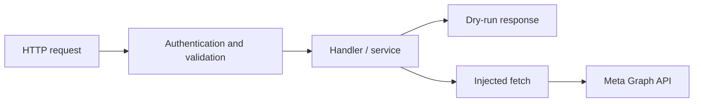

# WhatsApp Gateway — Express

A TypeScript HTTP service for WhatsApp Business Cloud API webhooks and outbound
text messages, implemented with **Express**. Signed webhooks, authenticated
sending, validated payloads, and an injectable provider make its boundaries testable.

**Node.js 22.12+ · TypeScript strict · 14 tests · Vitest + Supertest · MIT**

Compare the [sibling implementation](https://github.com/TheLionGab/whatsapp-gateway-nestjs)
for the same core routes in a different architecture. These are two implementations
of one service. Neither has been verified against the live Meta API here.

## Quick start: no Meta account required

```bash
git clone https://github.com/TheLionGab/whatsapp-gateway-express.git
cd whatsapp-gateway-express
npm ci
npm run build
DRY_RUN=true WHATSAPP_VERIFY_TOKEN=local-demo npm start
```

In another terminal:

```bash
curl http://localhost:3000/health
curl -X POST http://localhost:3000/messages/text \
  -H 'Content-Type: application/json' \
  -d '{"to":"5565999990000","body":"local demonstration"}'
```

The send response includes `providerId: "dry-run-wamid.123"`; no message is sent.
Dry-run without an app secret or send key intentionally skips those checks.
Outside dry-run, both are required at startup.

## Architecture



HTTP routes in `src/app.ts` compose Zod validation, security helpers,
configuration, logging, and the provider in `src/services/whatsapp.ts`.
`createApp` accepts a `fetchImpl` dependency, so tests exercise HTTP without Meta.

## HTTP contract

| Endpoint | Result | Failure |
| --- | --- | --- |
| `GET /health` | `{ "status": "ok", "service": "whatsapp-cloud-api-node" }` | — |
| `GET /webhook` | Echoes `hub.challenge` with valid `hub.mode=subscribe` and `hub.verify_token`. | 403 `verify_failed` |
| `POST /webhook` | `{ "received": true }` after raw-body signature verification when a secret is configured. | 401 `invalid_signature` |
| `POST /messages/text` | Sends `{ "to": "5565999990000", "body": "hello", "previewUrl": false }` with `Authorization: Bearer <SEND_API_KEY>`. | 401 `unauthorized`, 400 `invalid_body`, 502 `provider_error`, or 500 `missing_credentials` |

Application errors use `{ "error": { "code": "...", "message": "..." } }`;
validation errors also include `details`. The health service identifier keeps
its original value in both projects to preserve the existing HTTP contract.

## Engineering Decisions & Test Strategy

| Incorrect implementation | Decision | Regression evidence |
| --- | --- | --- |
| Accept a forged webhook or a signature for a different body. | Verify HMAC-SHA256 over the original bytes, using constant-time comparison. | `tests/api.test.ts` rejects missing, wrong, and other-body signatures. |
| Allow unauthenticated outbound sends. | Check the bearer send key before validating message input. | Missing and incorrect key cases return 401. |
| Make the test suite send real messages. | Inject `fetch` and provide a dry-run branch. | Provider request and dry-run tests use a fake provider. |
| Leak credentials through request logs. | Redact sensitive headers and serialize URL paths without query strings. | Logging tests inspect captured output for sensitive fields. |

```bash
npm run typecheck
npm test
npm run build
npm run test:local
```

The 14-case suite uses local HTTP and injected provider responses; it needs no
external API after `npm ci`. Dependency installation requires network access
unless npm's cache is already populated. The existing `test:local` script is
a curl smoke demonstration, not an assertion-based acceptance suite.
CI runs typecheck, tests, and build on Node 22, plus the curl smoke script.

For development:

```bash
npm run dev
```

## Configuration

| Variable | Purpose |
| --- | --- |
| `PORT` | HTTP port, default 3000. |
| `WHATSAPP_VERIFY_TOKEN` | Required webhook verification value, including in dry-run. |
| `DRY_RUN` | `true` or `1` returns a local response instead of calling Meta. |
| `WHATSAPP_APP_SECRET` | Webhook signature secret; required outside dry-run. |
| `SEND_API_KEY` | Outbound bearer key; required outside dry-run. |
| `WHATSAPP_TOKEN` / `WHATSAPP_PHONE_NUMBER_ID` | Provider credentials, checked when sending outside dry-run. |
| `WHATSAPP_GRAPH_VERSION` | Graph version, default `v22.0`; this is the code default, not a claim about Meta's latest version. |
| `LOG_LEVEL` | Log verbosity, default `info`. |

## Tradeoffs and limitations

Express 4 supplies its default HTML responses for unmatched routes and some
parser errors. This implementation has no configured ESLint gate; use the
typecheck, tests, and build commands below.

No rate limiting, key rotation, templates, media, queue, retries, or persisted
delivery state. Webhook receipt acknowledges events; it does not implement a
business processing pipeline. Tests verify local behavior and the mocked
provider boundary, not live Meta interoperability or production readiness.
